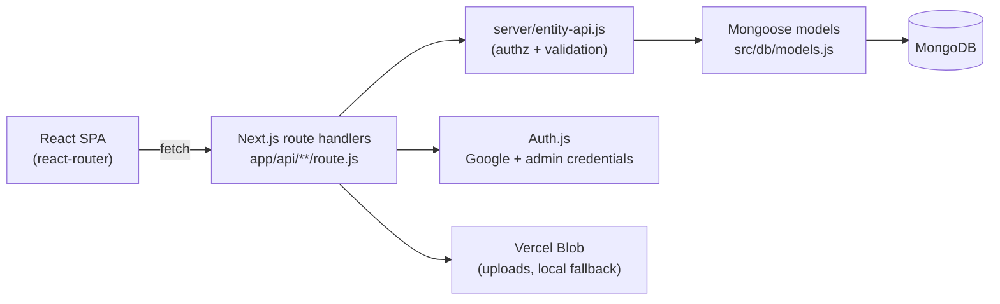

<div align="center">

# 🎟️ EventPass

### Publish events. Take registrations. Scan tickets at the door.

<p>
  
  
  
  
  
</p>

A self-hosted event registration and ticketing app — guest or account sign-ups,
QR tickets rendered **fully offline**, and a camera-based **QR check-in scanner**
for door staff, with an admin dashboard over everything.

</div>

---

## ✨ Features

| | |
|---|---|
| 📅 **Events** | Publish events with covers, venues, schedules, capacity, registration windows, and custom form fields |
| 🎫 **Registration** | Guests (email, no account) or signed-in users — one ticket per person per event, enforced in code *and* at the database level |
| 🔳 **Offline QR tickets** | Every ticket gets a razor-sharp SVG QR, encoded and rendered on-device — no image APIs, no network |
| 📷 **QR check-in scanner** | Admin camera page with a built-in QR detector (finder localization, perspective correction, Reed–Solomon error correction); the camera stays live after a scan, with a progress modal and queued scans while check-ins complete. Idempotent repeat scans, plus manual entry by link, token, or `REG-YYYY-XXXXXX` number |
| 🔍 **Find my ticket** | Guests retrieve tickets by email — no account needed |
| 🛡️ **Admin area** | Dashboard, events, registrations (search/filter/CSV import-export), per-registration check-in, settings |
| 📱 **Mobile-first** | Auth-aware hamburger menus on site and admin; staff-friendly door flow |

---

## 🏗️ Architecture



- The SPA shell (`app/[[...slug]]`) hosts the existing React app unchanged; the old Base44 `db` shim (`src/api/db.js`) is now fetch calls against the route handlers.
- Server errors are JSON `{ message }` with proper HTTP status, so client `catch` blocks (`e.message` / `e.status`) keep working.
- The DB connection is lazy — `next build` never needs credentials.

### Authorization model

| Entity | Read | Write |
|---|---|---|
| **Event** | Published events are public; admins also see events they created or are linked to | Admin only; linked-admin list is owner-only |
| **Registration** | Admins: all · Users: own only · Guests: by ticket id only | Anyone may create (`user_id` is resolved server-side, never trusted); update/delete admin only |
| **User** | Self or admin | Admin only |
| **Setting** | Public | Admin only |

Guests can search for tickets by email or name (`/find-ticket`), but opening a ticket (`/tickets/:registration`) requires a signed-in account; the API denies anonymous ticket reads as well. The one exception is the signed download link in the ticket email: `/t/<code>?download=1` opens a minimal page that starts the download and closes itself, with no session required — the HMAC signature proves the link came from an email.

---

## 🚀 Quickstart

```bash
npm install
cp .env.example .env.local   # then fill in values (table below)
# start a local MongoDB (mongod) on the MONGODB_URI host/port
npm run db:seed              # optional: admin user + sample event
npm run dev                  # http://localhost:3000
```

### Environment variables

| Variable | Purpose |
|---|---|
| `MONGODB_URI` | MongoDB connection string (`mongodb://127.0.0.1:27017/event_pass` locally; Atlas in prod) |
| `AUTH_SECRET` | NextAuth JWT secret (`npx auth secret`) |
| `AUTH_GOOGLE_ID` / `AUTH_GOOGLE_SECRET` | Google OAuth client (from the `client_secret*.json` download) |
| `ADMIN_EMAILS` | Comma-separated accounts granted the admin role |
| `ADMIN_PASSWORD` | Shared admin email/password sign-in (empty disables it) |
| `BLOB_READ_WRITE_TOKEN` | Vercel Blob token (auto-provided on Vercel; locally uploads fall back to `public/uploads/`) |
| `APP_URL` | Public app URL used for links inside emails (defaults to `NEXTAUTH_URL`, then localhost) |
| `SMTP_HOST` / `SMTP_PORT` / `SMTP_SECURE` / `SMTP_USER` / `SMTP_PASS` / `MAIL_FROM` | Bootstrap fallback SMTP sender for ticket delivery. **Optional:** when `SMTP_HOST` is unset, no env-based mail is sent. Later phases use per-admin Gmail accounts from the database instead |
| `MAIL_DEFAULT_PROVIDER` | Main mail provider; defaults to `gmail` |
| `MAIL_CREDENTIALS_KEY` | Base64 32-byte AES key for encrypting stored Gmail App Passwords. Required only when per-admin accounts are used. Generate with `node --input-type=module -e "import {randomBytes} from 'node:crypto'; console.log(randomBytes(32).toString('base64'))"` |
| `MAIL_SEND_INTERVAL_MS` | Delay between individual bulk emails; default `400` |
| `MAIL_BATCH_POLL_MS` | UI polling interval for bulk-send progress; default `2000` |
| `MAIL_BATCH_CHUNK_SIZE` | Registrations per bulk-send API request; default `20` |
| `UPSTASH_REDIS_REST_URL` / `UPSTASH_REDIS_REST_TOKEN` (or `KV_REST_API_URL` / `KV_REST_API_TOKEN`), **or** `REDIS_URL` | **Optional** Redis, for rate limiting (`/api/guest-tickets`, guest registration, check-in) and a 60s public event-list cache. REST (Upstash) is preferred on serverless; a TCP `redis://` URL (Redis Cloud marketplace integration) is also supported. Unset = both disabled, app behaves as before. A Redis outage is treated as a cache miss, never as an error |

> Google tip: the OAuth client needs `http://localhost:3000/api/auth/callback/google` locally, plus your production callback URL when deployed. The OAuth flow requires POST initiation — handled in `src/api/db.js`.

Additional admins can be created from `/admin/users`. They sign in with Google using the created email; shared-password sign-in still requires that email in `ADMIN_EMAILS`. Each admin user has a `default_mail_account_id` field that points to their own Gmail mail account.

Gmail accounts are managed at `/admin/mail-accounts`. Each admin can add their own Gmail address + App Password, set a 500/day limit, send a styled sample ticket to verify the sender, and choose which account is the default for automatic ticket emails. Accounts can optionally be shared with other admins; only the owner can edit or delete them. App Passwords are encrypted with `MAIL_CREDENTIALS_KEY` and are never returned in plaintext.

Mail accounts can be backed up and restored with **Export** / **Import** on that page. The JSON export contains the stored AES-GCM credential payload (never the plaintext App Password) plus a `MAIL_CREDENTIALS_KEY` fingerprint. Imports are assigned to the signed-in admin; duplicate emails are skipped by default, or updated when **Update existing accounts** is enabled. Encrypted credentials restore only on a deployment using the same `MAIL_CREDENTIALS_KEY`; if the key differs, import reports the affected rows so the App Passwords can be re-entered. Keep exported files private.

Ticket emails use a premium delivery template: branded header, two-column event details (Date/Time on the left, Venue on the right), an inline QR code, a **View your ticket** button, a **Download ticket image** link, and a support footer. There are no downloadable file attachments — the QR is an inline CID image (`cid:ticketqr`), which renders reliably in Gmail and other clients that strip data URIs. The **Download ticket image** link is the signed `/t/[code]?download=1` URL: it opens a tiny landing page that downloads a high-resolution 4 × 6 portrait image and then closes the tab, without requiring sign-in. The adjacent **View your ticket** link still requires an account — it redirects to the official ticket page.

Guests can download a 4 × 6 portrait WebP or JPEG that mirrors the current `TicketCard` UI: 4:3 cover header, two-column event details, perforated divider, guest/registration field-details list, and QR stub. The event cover is used as the header background when set (local `/uploads/...` files are read directly from disk; remote URLs are fetched). Text is converted to SVG paths with the bundled Geist font, so downloads render correctly on Vercel without relying on serverless system fonts. Signed-in users download via `GET /api/tickets/[ticket]/image?format=webp|jpeg`, which uses the normal ticket read permissions; guests use `GET /api/tickets/download/[code]?format=webp|jpeg`, which authorizes the same image builder with the short-link HMAC instead of a session.

Ticket links in emails are shortened to `/t/<code>` and signed with `SHORT_LINK_SECRET` (falls back to `NEXTAUTH_SECRET`/`MAIL_CREDENTIALS_KEY`). The view link redirects to the full `/tickets/[id]` page while the download link uses `/api/tickets/download/[code]`, so changing the secret invalidates previously sent email links.

An event owner can link other admins to an event from the **Admins** button on the event card or event detail page. Linked admins see that event in their own admin list and can view/manage it even while unpublished. Only the owner can add or remove links; legacy events with no owner can be managed by any admin.

Bulk ticket emailing is available from `/admin/events/:event/registrations`: select registrations, click **Email N**, choose a Gmail account, and send. Cancelled registrations and rows without a valid email are skipped; CSV duplicate markers such as `name@example.com#2` are normalized to the real address before sending. The dialog shows live per-email status (`queued → sending → sent/failed/skipped`), and the registrations table keeps a permanent **Email** status. Sends are paced with `MAIL_SEND_INTERVAL_MS` and processed in chunks of `MAIL_BATCH_CHUNK_SIZE`. The single-registration page does not send email.

---

## 🧭 Routes

**Public:** `/` · `/events` · `/events/:slug` · `/register/:slug` · `/login` · `/find-ticket` · `/checkin/:qrToken` (admin-gated auto check-in)

**Account:** `/my-events` · `/profile` · `/tickets/:registration`

**Admin:** `/admin` · `/admin/events` (+ `/create`, `/:event`, `/:event/edit`, `/:event/registrations`) · `/admin/registrations/:registration` · `/admin/checkin` (QR scanner) · `/admin/users` · `/admin/mail-accounts` · `/admin/settings`

**API:** `/api/auth/[...nextauth]` · `/api/auth/me` · `/api/entities/[entity]`(+`/[id]`) · `/api/guest-tickets` · `/api/public-settings` · `/api/uploads` · `/api/tickets/[ticket]/image` · `/api/tickets/download/[code]` · `/t/[code]` · `/api/admin/checkin` · `/api/admin/mail-accounts`(+`/[id]`, `/[id]/test`) · `/api/admin/events/[event]/admins`(+`/[admin]`) · `/api/admin/events/[event]/mail-batch`(+`/[batch]`, `/[batch]/process`, `/[batch]/cancel`)

---

## 🧪 Development

```bash
npm run dev         # Next.js dev server
npm run build       # production build (needs no env vars)
npm run start       # serve the production build
npm run lint        # eslint, errors only
npm run lint:fix    # eslint --fix
npm run typecheck   # tsc over jsconfig
npm run db:seed     # seed admin + sample event (uses MONGODB_URI)
```

## ☁️ Deploy (Vercel)

1. Import the repo; set all env vars above (**Atlas** `MONGODB_URI`, Blob token, auth secrets, `NEXTAUTH_URL=https://your-app.vercel.app`).
2. Google Cloud Console → OAuth client → add `https://your-app.vercel.app/api/auth/callback/google` to authorized redirect URIs.
3. Run `npm run db:seed` once against the production database; grant yourself admin via `ADMIN_EMAILS`.

---

<div align="center">
<sub>Built with Next.js · MongoDB · Auth.js — tickets that scan even with the Wi-Fi down. 🎟️</sub>
</div>
