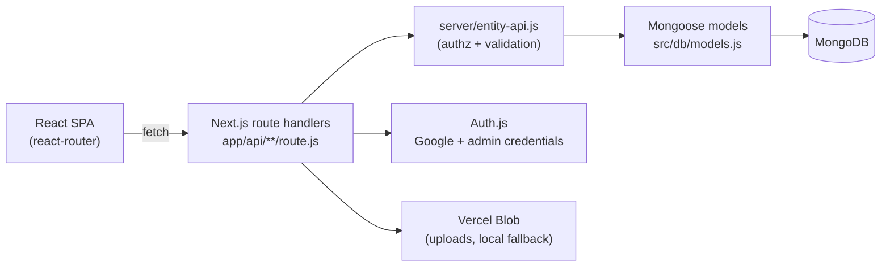

<div align="center">

# 🎟️ EventPass

### Publish events. Take registrations. Scan tickets at the door.

<p>
  
  
  
  
  
</p>

A self-hosted event registration and ticketing app — guest or account sign-ups,
QR tickets rendered **fully offline**, and a camera-based **QR check-in scanner**
for door staff, with an admin dashboard over everything.

</div>

---

## ✨ Features

| | |
|---|---|
| 📅 **Events** | Publish events with covers, venues, schedules, capacity, registration windows, and custom form fields |
| 🎫 **Registration** | Guests (email, no account) or signed-in users — one ticket per person per event, enforced in code *and* at the database level |
| 🔳 **Offline QR tickets** | Every ticket gets a razor-sharp SVG QR, encoded and rendered on-device — no image APIs, no network |
| 📷 **QR check-in scanner** | Admin camera page with a built-in QR detector (finder localization, perspective correction, Reed–Solomon error correction); idempotent repeat scans, plus manual entry by link, token, or `REG-YYYY-XXXXXX` number |
| 🔍 **Find my ticket** | Guests retrieve tickets by email — no account needed |
| 🛡️ **Admin area** | Dashboard, events, registrations (search/filter/CSV import-export), per-registration check-in, settings |
| 📱 **Mobile-first** | Auth-aware hamburger menus on site and admin; staff-friendly door flow |

---

## 🏗️ Architecture



- The SPA shell (`app/[[...slug]]`) hosts the existing React app unchanged; the old Base44 `db` shim (`src/api/db.js`) is now fetch calls against the route handlers.
- Server errors are JSON `{ message }` with proper HTTP status, so client `catch` blocks (`e.message` / `e.status`) keep working.
- The DB connection is lazy — `next build` never needs credentials.

### Authorization model

| Entity | Read | Write |
|---|---|---|
| **Event** | Published events are public; admins see all | Admin only |
| **Registration** | Admins: all · Users: own only · Guests: by ticket id only | Anyone may create (`user_id` is resolved server-side, never trusted); update/delete admin only |
| **User** | Self or admin | Admin only |
| **Setting** | Public | Admin only |

---

## 🚀 Quickstart

```bash
npm install
cp .env.example .env.local   # then fill in values (table below)
# start a local MongoDB (mongod) on the MONGODB_URI host/port
npm run db:seed              # optional: admin user + sample event
npm run dev                  # http://localhost:3000
```

### Environment variables

| Variable | Purpose |
|---|---|
| `MONGODB_URI` | MongoDB connection string (`mongodb://127.0.0.1:27017/event_pass` locally; Atlas in prod) |
| `AUTH_SECRET` | NextAuth JWT secret (`npx auth secret`) |
| `AUTH_GOOGLE_ID` / `AUTH_GOOGLE_SECRET` | Google OAuth client (from the `client_secret*.json` download) |
| `ADMIN_EMAILS` | Comma-separated accounts granted the admin role |
| `ADMIN_PASSWORD` | Shared admin email/password sign-in (empty disables it) |
| `BLOB_READ_WRITE_TOKEN` | Vercel Blob token (auto-provided on Vercel; locally uploads fall back to `public/uploads/`) |

> Google tip: the OAuth client needs `http://localhost:3000/api/auth/callback/google` locally, plus your production callback URL when deployed. The OAuth flow requires POST initiation — handled in `src/api/db.js`.

---

## 🧭 Routes

**Public:** `/` · `/events` · `/events/:slug` · `/register/:slug` · `/login` · `/find-ticket` · `/tickets/:registration` · `/checkin/:qrToken` (admin-gated auto check-in)

**Account:** `/my-events` · `/profile`

**Admin:** `/admin` · `/admin/events` (+ `/create`, `/:event`, `/:event/edit`, `/:event/registrations`) · `/admin/registrations/:registration` · `/admin/checkin` (QR scanner) · `/admin/settings`

**API:** `/api/auth/[...nextauth]` · `/api/auth/me` · `/api/entities/[entity]`(+`/[id]`) · `/api/guest-tickets` · `/api/public-settings` · `/api/uploads` · `/api/admin/checkin`

---

## 🧪 Development

```bash
npm run dev         # Next.js dev server
npm run build       # production build (needs no env vars)
npm run start       # serve the production build
npm run lint        # eslint, errors only
npm run lint:fix    # eslint --fix
npm run typecheck   # tsc over jsconfig (pre-existing errors only)
npm run db:seed     # seed admin + sample event (uses MONGODB_URI)
```

## ☁️ Deploy (Vercel)

1. Import the repo; set all env vars above (**Atlas** `MONGODB_URI`, Blob token, auth secrets, `NEXTAUTH_URL=https://your-app.vercel.app`).
2. Google Cloud Console → OAuth client → add `https://your-app.vercel.app/api/auth/callback/google` to authorized redirect URIs.
3. Run `npm run db:seed` once against the production database; grant yourself admin via `ADMIN_EMAILS`.

---

<div align="center">
<sub>Built with Next.js · MongoDB · Auth.js — tickets that scan even with the Wi-Fi down. 🎟️</sub>
</div>
